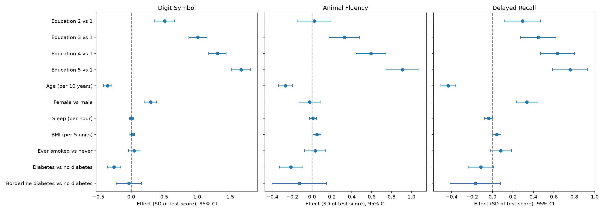

# NHANES 2011–2012: biological and lifestyle factors associated with cognitive performance in adults aged 60+

## Research question
Can cognitive performance in older adults be explained by biological and lifestyle factors
(age, sex, education, sleep, BMI, smoking, diabetes)?

## Data
Source: [CDC NHANES](https://wwwn.cdc.gov/nchs/nhanes/), 2011–2012 cycle. Files used:
`DEMO_G` (demographics), `CFQ_G` (cognitive tests), `SLQ_G` (sleep), `BMX_G` (body measures),
`SMQ_G` (smoking), `DIQ_G` (diabetes).

Participants aged 60+: 1,687. Analysis sample (complete data on all variables): **N = 1,332**.

Outcomes:
- `CFDDS`: Digit Symbol Coding (processing speed, 0–100)
- `CFDAST`: Animal Fluency (verbal fluency, 1–40)
- `CFDCSR`: CERAD Delayed Recall (memory, 0–10)

Predictors: education (5 levels), age, sex, sleep duration (hours), BMI, smoking history, diabetes.

## Methods
- Data preparation: merging NHANES files by participant ID (`SEQN`), restricting to age 60+,
  recoding refused/don't know answers as missing.
- Descriptive analysis and correlations between age, sleep and test scores.
- Missing data analysis: logistic regression for the probability that a test result is missing.
- Multiple linear regression (OLS) for each outcome on the same participants (complete cases).
- Breusch-Pagan tests indicated heteroskedasticity for Animal Fluency (p = 0.001) and Delayed Recall
  (p = 0.0025) but not for Digit Symbol (p = 0.22), so HC3 heteroskedasticity-robust standard errors
  are used for all models.
- Model diagnostics: residuals vs fitted values, Q-Q plots, variance inflation factors
  (all below 2.4, no multicollinearity concern).
- Effect sizes: coefficients with 95% confidence intervals and standardized effects
  (test score in SD units).

## Key results
All estimates are adjusted for the other predictors. Values are coefficients (95% CI) in test points.

| Factor | Digit Symbol | Animal Fluency | Delayed Recall |
|---|---|---|---|
| Education 5 vs 1 | +29.1 (26.6 to 31.6) | +5.0 (4.1 to 5.9) | +1.73 (1.34 to 2.12) |
| Age (per year) | −0.62 (−0.73 to −0.51) | −0.146 (−0.185 to −0.107) | −0.099 (−0.115 to −0.082) |
| Female vs male | +5.2 (3.6 to 6.7) | −0.13 (−0.72 to 0.46) | +0.77 (0.54 to 1.00) |
| No diabetes vs diabetes | +4.6 (2.9 to 6.3) | +1.16 (0.54 to 1.79) | +0.26 (−0.02 to 0.54) |
| BMI (per unit) | +0.05 (−0.07 to 0.17) | +0.055 (0.012 to 0.098) | +0.019 (0.001 to 0.037) |
| Sleep (per hour) | +0.08 (−0.45 to 0.61) | +0.05 (−0.14 to 0.24) | −0.087 (−0.175 to 0.001) |
| Never vs ever smoked | −0.78 (−2.31 to 0.76) | −0.18 (−0.76 to 0.41) | −0.19 (−0.42 to 0.05) |

R² (adjusted R²): 0.415 (0.411) for Digit Symbol, 0.168 (0.161) for Animal Fluency,
0.199 (0.192) for Delayed Recall.



Main findings:
- Higher education is associated with better performance on all three tests, most strongly for Digit Symbol.
- Older age is independently associated with lower scores on all three tests.
- Diabetes is associated with lower Digit Symbol and Animal Fluency scores.
- Women scored higher than men on Digit Symbol and Delayed Recall.
- BMI associations were very small (about +0.3 words per 5 BMI units for Animal Fluency). BMI was higher
  in people with diabetes (mean 31.2 vs 28.3), and the BMI coefficient for Animal Fluency was slightly
  larger after adjusting for diabetes (0.040 to 0.055), but this change is small.
- No linear association with sleep duration or smoking history was detected. This does not exclude
  non-linear effects.

## Interpretation
The strong association with education is consistent with the cognitive reserve hypothesis: more years of
education may help maintain performance despite age-related brain changes. Lower Digit Symbol and
Animal Fluency scores in people with diabetes are consistent with reports that metabolic and vascular
factors affect brain health. The small positive BMI association should not be read as a benefit of higher
weight: unintentional weight loss may precede cognitive decline in older adults (reverse causation).
All associations are cross-sectional and do not show causal effects.

## Limitations
- Cross-sectional design: associations, not causal effects.
- NHANES survey weights and the complex sampling design are not yet accounted for in the main models,
  so p-values and standard errors are preliminary.
- Test results are missing in 14–16% of participants, and missingness is not random: it is higher in older
  participants (OR ≈ 1.08 per year for Digit Symbol) and in those with less education (33% missing in the
  lowest vs 8% in the highest education group for Digit Symbol). People who could not complete the tests may
  have lower cognitive performance, so the associations with education and age may be underestimated.
- Sleep, smoking and diabetes are self-reported.
- Age is top-coded at 80 in NHANES (80 means 80 years and older).
- The borderline diabetes group is small (n = 45).
- Several outcomes and many coefficients were tested, so small associations (p around 0.01–0.05)
  should be interpreted cautiously.

## How to reproduce
1. Install the packages: `pip install -r requirements.txt`
2. Download the `.XPT` files listed above from the CDC NHANES website (2011–2012) into `data/raw/`.
3. Run the scripts in order:
   - `scripts/01_prepare_data.py`: builds `data/processed/nhanes_cognitive_60plus.csv`
   - `scripts/02_check_raw_data.py`: checks the raw data
   - `scripts/03_analysis.py`: runs the analysis and saves tables and figures to `results/`

## Project structure
```text
nhanes-cognition/
├── README.md
├── requirements.txt
├── data/
│   ├── raw/          # NHANES .XPT files (not tracked in git)
│   └── processed/    # analysis dataset (CSV)
├── scripts/          # data preparation and analysis
└── results/
    ├── figures/      # forest plot, diagnostics
    └── tables/       # regression, missing data, VIF tables
```